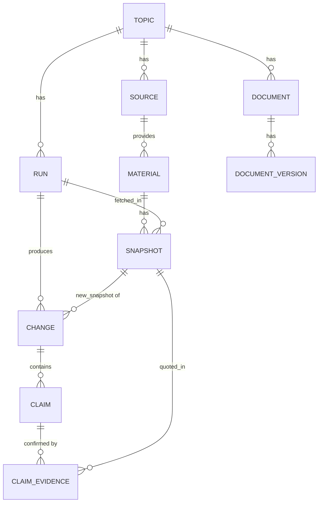

# 01. Предметная область: словарь и модель

## 1. Глоссарий

> Один термин = одно название везде: в коде, БД, промптах.

| Термин          | Определение                                                                                                                       | Название в коде |
| --------------- | --------------------------------------------------------------------------------------------------------------------------------- | --------------- |
| Topic           | Предметная область, которую отслеживаем (в MVP одна)                                                                              | Topic           |
| Source          | Источник, заданный пользователем (сайт, RSS, arXiv)                                                                               | Source          |
| Material        | Отдельная статья или страница из источника. Идентичность: (Source, external_id)                                                   | Material        |
| Snapshot        | Версия содержимого Material на момент проверки. Создаётся только при изменении хэша нормализованного текста                       | Snapshot        |
| Change          | Значимое изменение: новый Material или значимая правка. Содержит текст для пользователя                                           | Change          |
| Section         | Раздел Description: заголовок + текст. Не сущность БД, часть файла. Идентификатор sectionId = slug заголовка, заголовки уникальны | Section         |
| Claim           | Утверждение в документе (только текст). Подтверждается через Evidence                                                             | Claim           |
| Evidence        | Подтверждение утверждения: Snapshot + цитата                                                                                      | ClaimEvidence   |
| Run             | Один запуск мониторинга (по расписанию, вручную или догоняющий)                                                                   | Run             |
| Document        | Выходной документ системы. Виды: Description (описание темы), Changelog (журнал)                                                  | Document        |
| DocumentVersion | Версия Description, неизменяемый файл. Текущая = с максимальным номером                                                           | DocumentVersion |
| Changelog       | Журнал изменений для пользователя: Change, сгруппированные по моменту фиксации в описании (done_at). Не таблица, а представление  | (представление) |
| Run log         | Технический лог: что система делала, включая «изменений нет»                                                                      | Serilog + runs  |

Важно: «Material» (внешний) и «Document» (наш) не смешиваем.

external_id: guid записи для RSS, id для arXiv без суффикса версии, для остальных канонический URL (без utm, фрагмента и хвостового слэша).

## 2. Сущности и связи

## 3. Виды изменений

| Вид | Определение | Пример | Хранится |
|---|---|---|---|
| Новое | Material, которого не было раньше | Новая статья на habr по теме | Change |
| Обновлено (значимое) | У существующего Material добавлена новая информация | В статью добавлен раздел | Change |
| Шум (незначимое) | Правка без новой информации: опечатка, дата, счётчик, реклама | Исправили опечатку | Только Snapshot, Change нет |
| Удалено | Material пропал из выдачи | вне MVP | не обрабатываем |

Правило: Material, отсутствующий в выдаче, не считается удалённым, его просто не трогаем.

## 4. Понятия (Concepts)

Вне MVP как сущность. Понятия присутствуют в тексте описания. Пересмотреть, если понадобятся связи между понятиями.

## 5. Журнал

- Каждое изменение это отдельный Change.
- Для пользователя Change группируются по done_at (одна версия описания = одна группа).
- Запуск без Change не показывается пользователю, фиксируется только в `runs` и логе.

## 6. Проверка информации (Claim)

- Каждое утверждение в Description хранится как Claim (текст). Цитаты и ссылки на Snapshot лежат в ClaimEvidence
- Код проверяет: у Claim есть минимум одно Evidence, цитата найдена в clean_text его Snapshot
- «N источников» = число разных Material среди Evidence одного Claim
- Мягкая проверка: Claim с одним источником не блокирует обновление документа, а только получает пометку.

## 7. Инварианты

- У каждого Change есть ссылка на новый Snapshot и (для «Обновлено») на предыдущий.
- Каждый Change принадлежит ровно одному Run.
- Каждое Evidence ссылается на Snapshot, и цитата найдена в его clean_text. У каждого Claim минимум одно Evidence
- Каждый Snapshot создан в рамках одного Run
- Версии Description неизменяемы, номера уникальны в пределах документа
- Snapshot создаётся только при изменении хэша нормализованного текста.
- Material уникален по (source_id, external_id).
- Новая версия Description не теряет прежние сведения; прежняя сохраняется как DocumentVersion.
- Запуск без Change не меняет Description и не пишет в Changelog.
- Change в статусе Done имеет summary и done_at, его правки включены в версию Description того же Run.
- Каждый маркер [c:id] версии Description ссылается на существующий Claim.
- Change в статусе Skipped не имеет `done_at` и не попадает в Changelog. Skipped бывает двух видов: материал не по теме (`relevant = false`) или материал только подтвердил существующие Claims (есть `confirms`, нет `operations`). Во втором случае Evidence записаны в той же транзакции, что и статус.
- Запуск, в котором все принятые Change только подтвердили Claims, не создаёт новую версию Description.