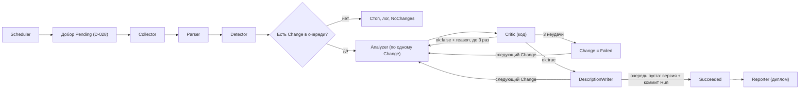
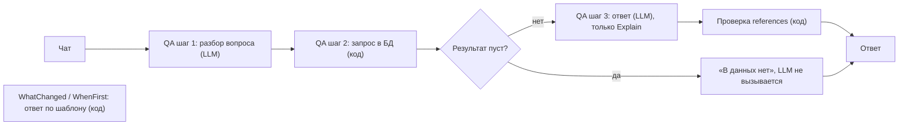

# 02. Архитектура

## 1. Граф агентов

### Запуск (Run), MVP

Change обрабатываются строго по очереди: следующий должен видеть описание с правками предыдущего (D-027).



Очередь Change = Pending с прошлых запусков + новые от Detector.

### Вопрос пользователя (QA)

Запускается из чата, не из Run. Не меняет данные.



## 2. Код или агент

| Шаг                              | Код / LLM                 | Почему                                                                                                                                           |
| -------------------------------- | ------------------------- | ------------------------------------------------------------------------------------------------------------------------------------------------ |
| Расписание                       | код                       | Проверка «прошёл ли интервал», LLM не нужна (D-024)                                                                                              |
| Сбор                             | код                       | Детерминированная сеть и разбор RSS/Atom/API                                                                                                     |
| Парсинг                          | код                       | Детерминирован, на тех же данных тот же результат (D-025)                                                                                        |
| Сравнение, значимость (Detector) | код (хэш + diff + пороги) | Запуск без изменений стоит 0 токенов (D-009), значимость решает код (D-020)                                                                      |
| Анализ                           | LLM                       | Нужно понять текст: релевантность, claims, в какой раздел писать                                                                                 |
| Критик                           | код (LLM на диплом)       | Проверяемые вещи (JSON, цитаты, маркеры) дешевле и надёжнее проверять кодом (D-025)                                                              |
| Сборка описания                  | код                       | Применяет операции, старый текст не трогается: потеря сведений невозможна по построению (D-027)                                                  |
| Отчёт                            | диплом (LLM)              | Не нужен для критериев MVP (D-026)                                                                                                               |
| Вопросы                          | гибрид                    | LLM разбирает вопрос; ответ по шаблону (код) для WhatChanged и WhenFirst, LLM по найденному для Explain, код выполняет запросы: LLM не пишет SQL |

## 3. Состояние запуска (Run state)

Живёт в памяти (`RunContext`), шаги не персистятся. После падения возобновляемся через добор Pending (D-028). В БД только `runs` (статус, stats, токены) и `changes.status`.

```json
{
  "runId": 0,
  "topicId": 0,
  "trigger": "Scheduled | Manual | CatchUp",
  "step": "",
  "description": { "sections": [] },
  "queue": [ 123, 124 ],
  "retries": { "123": 1 },
  "tokensUsed": 0,
  "llmModelUsed": "",
  "promptVersion": 0,
  "fallbackReason": null,
  "newBudget": 10,
  "newClaims": [],
  "newEvidence": [],
  "stats": { "checked": 0, "new": 0, "updated": 0, "noise": 0, "failed": 0, "analysisFailed": 0, "analyzerCalls": 0, "skipped": 0, "confirmOnly": 0, "overBudget": 0, "pending": 0 }
}
```

- `description`: описание с уже применёнными правками этого Run. Файл пишется один раз в конце.
- `retries`: попытки Analyzer по `changeId`.
- `queue`: id Change в порядке обработки.
- newClaims / newEvidence: принятые в этом Run Claims (id зарезервированы) и их подтверждения, в БД попадают в финальной транзакции (09).

## 4. Слои и проекты

| Слой          | Проект         | Ответственность                                                                                                                                                            | Зависит от                                                  |
| ------------- | -------------- | -------------------------------------------------------------------------------------------------------------------------------------------------------------------------- | ----------------------------------------------------------- |
| Core          | `Core`         | Сущности, C# records контрактов, интерфейсы (`IScheduler`, `IRunPipeline`, `ISignificanceJudge`, `ICritic`, тулы, `IMonitoringService`)                                    | ничего                                                      |
| Storage       | `Storage`      | DbContext, миграции EF, запросы из 04                                                                                                                                      | Core                                                        |
| Tools         | `Tools`        | Реализации тулов: Rss/Arxiv/Html-сборщики, SmartReader, DiffPlex, LLM-клиент и FallbackLlmClient (декоратор), IRobotsPolicy                                                | Core                                                        |
| Agents        | `Agents`       | Collector, Parser, Detector, Analyzer, Critic, DescriptionWriter, QA. Агент собирает работу из тулов                                                                       | Core, Storage                                               |
| Orchestrator  | `Orchestrator` | `FixedRunPipeline`, RunContext, повторы, планировщик, реализация `IMonitoringService`, регистрация DI (`AddMonitoring()`)                                                  | Core, Storage, Agents, Tools                                |
| Interface     | `App`          | Avalonia, трей, Mutex, автозапуск. Только тонкий UI                                                                                                                        | Core (фасад), Orchestrator (только вызов `AddMonitoring()`) |
| Консоль (dev) | `Cli`          | Консольный хост для разработки и демонстрации: команды `setup`, `collect`, `detect`, `run`, `watch`, `ask`, `status`, `doc`, `changes`. Только вызовы `IMonitoringService` | Core (фасад), Orchestrator (только `AddMonitoring()`)       |
| Тесты         | `Tests`        | NUnit, NSubstitute, Testcontainers                                                                                                                                         | всё                                                         |

Правила:
- Core ни от чего не зависит.
- UI и Cli ходят только через `IMonitoringService`: `StartMonitoring`, `RunNow`, `GetStatus`, `Ask`, `GetChangesSinceLastRun`, `GetChangelog(before)`, `GetDocuments` плюс событие прогресса для журнала «что система делает сейчас» (D-003, D-049).
- Агенты ходят в БД напрямую через DbContext, тесты на Testcontainers. Интерфейсы репозиториев вводим, если понадобится.
- Тест на зависимости: Core без ссылок, App и Cli не используют типы из Storage и Agents.

## 5. Структура решения

```
/src
  /GesDelta.Core
  /GesDelta.Storage
  /GesDelta.Tools
  /GesDelta.Agents
  /GesDelta.Orchestrator
  /GesDelta.App
  /GesDelta.Cli
/tests
  /GesDelta.Tests
/docs
/prompts
```

## 6. Оркестрация и тулы: заделы на диплом (D-029)

**Оркестратор в MVP:** обычный C#-класс, фиксированный конвейер, один Change за раз. За интерфейсом:

```csharp
public interface IRunPipeline
{
    Task<RunResult> ExecuteAsync(RunContext context, CancellationToken ct);
}
```

- MVP: `FixedRunPipeline` (порядок шагов зашит).
- Диплом: `AgenticRunPipeline` (LLM-планировщик сам выбирает, какой тул вызвать).

**Тул** = маленькая stateless-возможность за интерфейсом в Core. Примеры: `ISourceFetcher`, `IContentExtractor`, `ITextDiffer`, `ILlmClient`. Сменить библиотеку = новый класс и строка в DI, агента не трогаем. Общий `ITool<TIn,TOut>` не вводим.

**Правила для тулов (чтобы потом отдать их LLM через `AIFunctionFactory`):**
- без состояния, без побочных эффектов на БД (запись только в агентах и DescriptionWriter);
- простые параметры (строки, числа, простые records) и сериализуемый результат;
- у метода и параметров понятное описание (XML-doc или атрибут Description);
- ошибка возвращается значением (`ok:false, reason`), а не только исключением;
- не больше 10 тулов на агента (03).

**Что остаётся фиксированным и на дипломе:** значимость решает код (D-020), Critic проверяет цитаты кодом, запись в БД через агентов.

**Формулировка для защиты:** автономный по запуску и по решениям внутри шагов, фиксированная оркестрация в MVP ради надёжности на слабых моделях, адаптивная на дипломном этапе.

## 7. Точки расширения

| Что добавляем                     | Как                                                                        |
| --------------------------------- | -------------------------------------------------------------------------- |
| Новый источник                    | см. 05, раздел 7                                                           |
| Новая библиотека разбора/diff     | новая реализация тула + DI                                                 |
| Планировщик Quartz                | вторая реализация `IScheduler` (D-024)                                     |
| Значимость по смыслу (эмбеддинги) | вторая реализация `ISignificanceJudge` (D-021)                             |
| LLM-критик                        | реализация `ICritic`                                                       |
| Reporter                          | новый агент после DescriptionWriter (D-026)                                |
| LLM-планировщик                   | `AgenticRunPipeline : IRunPipeline` + тулы через `AIFunctionFactory`       |
| Новый тип вопроса QA              | новое значение `type`, новый параметризованный запрос в 04, ветка в шаге 2 |
| Автопоиск источников              | ISourceSearcher (Tavily/Brave) как тул для AgenticRunPipeline.             |