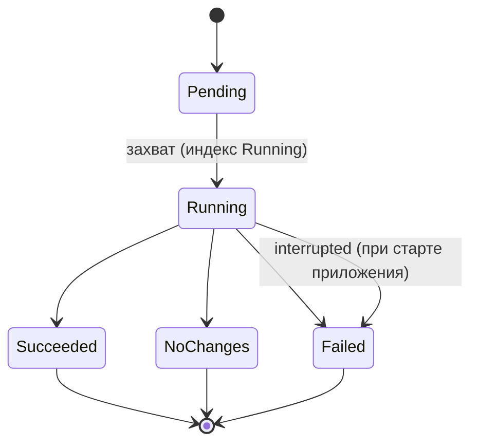

# 07. Оркестрация

Оркестратор: `FixedRunPipeline` (02, D-029). Change обрабатываются строго по очереди, параллелизма нет. Все числа ниже лежат в конфиге.

## 1. Ограничения запуска

| Параметр | Значение |
| --- | --- |
| Повторы Collector | 3, паузы 2 / 5 / 10 с. Только сеть, 5xx, 429. Реализация: Microsoft.Extensions.Http.Resilience |
| Попытки Analyzer | 3 всего (D-025). Считаются только отказы Critic |
| Повторы LLM: сеть, 5xx | 3, экспоненциальная пауза 5 / 15 / 45 с. В счёт попыток Critic не идут |
| Повторы LLM: 429 | 3, паузы 30 / 60 / 120 с. В счёт попыток Critic не идут |
| После исчерпания повторов LLM | свап модели по цепочке (раздел 2.1) |
| Повторы на весь запуск | лимита нет, ограничено структурой (3 на Change, 3 на сеть) |
| Токены на запуск | `MaxTokensPerRun`, по умолчанию выключен. При достижении: как «LLM недоступна» (раздел 3) |
| Стоимость | не считаем (бесплатные модели). `tokens_used` пишем в `runs` и в лог |
| Таймаут HTTP | 30 с |
| Таймаут вызова LLM | 120 с |
| Таймаут запуска | 60 мин |

```json
"Orchestration": {
  "Collector": { "Retries": 3, "PausesSec": [2, 5, 10], "HttpTimeoutSec": 30 },
  "Llm": {
    "CallTimeoutSec": 120,
    "NetworkRetries": 3, "NetworkPausesSec": [5, 15, 45],
    "RateLimitRetries": 3, "RateLimitPausesSec": [30, 60, 120],
    "Chain": [ { "Provider": "OpenRouter", "Model": "<основная>", "StructuredOutput": true }, { "Provider": "OpenRouter", "Model": "<вторая>", "StructuredOutput": false }, { "Provider": "Ollama", "Model": "<локальная>", "StructuredOutput": false, "NumCtx": 16384 } ],
    "MaxTokensPerRun": null
  },
  "Run": { "TimeoutMin": 60 },
  "Schedule": { "TickSec": 60, "RetryDelayMin": 60, "MaxConsecutiveUnclean": 3 }
}
```

## 2. Правила возврата назад

| Кто возвращает | Кому | Условие | Примечание |
| --- | --- | --- | --- |
| Critic | Analyzer | проверка не прошла и попыток < 3 | Текст замечания: `reason` + `retryHint` (03) |

Это единственный возврат по графу. Не возвраты: повторы внутри Collector и повторы/свап внутри `ILlmClient`. Parser → Collector не возвращает (D-025).

### 2.1. Цепочка моделей (свап)

Порядок из конфига: основная бесплатная модель OpenRouter → вторая бесплатная OpenRouter → Ollama. Вторая бесплатная идёт раньше Ollama: слабый ноутбук может не потянуть строгий JSON локально.

- **Триггеры свапа:** 429 после повторов, сеть или 5xx после повторов, таймаут вызова.
- **Не триггерит:** отказы Critic. Это качество ответа, а не доступность.
- **Срок:** свап держится до конца Run. Следующий Run начинает с основной модели. (для QA до конца вопроса, 08)
- **Счёт попыток:** вызов, повторённый на другой модели, не считается новой попыткой Critic.
- **Реализация:** `FallbackLlmClient : ILlmClient`, декоратор в Tools. Агенты про цепочку не знают.
- **Уведомление пользователю:** событие в журнал «что система делает сейчас» (например, «OpenRouter: лимит 429, перешёл на Ollama»), запись в Serilog, поля в `runs.stats`: `llmFallback`, `llmModelUsed`, `fallbackReason`.
- **Вся цепочка недоступна:** см. раздел 3.

## 3. После исчерпания повторов

| Что исчерпано                                       | Что происходит                                                                                                                                                                                                                                                                                       |
| --------------------------------------------------- | ---------------------------------------------------------------------------------------------------------------------------------------------------------------------------------------------------------------------------------------------------------------------------------------------------- |
| 3 попытки Analyzer (Critic)                         | Change = Failed, `error` заполнен, `stats.analysisFailed++`, запуск идёт дальше. Автоматически не повторяется                                                                                                                                                                                        |
| Вся цепочка LLM недоступна, или `MaxTokensPerRun`   | Текущий Change остаётся Pending. Очередь дальше не обрабатывается. Уже принятые правки коммитятся (версия описания, их Change = Done; Change только с `confirms` = Skipped вместе с их Evidence). Run = Succeeded, `stats.pending` = число оставшихся Pending. Остаток добирается следующим запуском |
| Повторы Collector                                   | Источник помечается `failed`, запуск продолжается с остальными                                                                                                                                                                                                                                       |
| Постоянная ошибка источника (404, `format_changed`) | Без повторов, источник `failed`, запуск продолжается                                                                                                                                                                                                                                                 |
| Таймаут запуска                                     | Run = Failed (`error = "timeout"`), правки в памяти не коммитятся, их Change остаются Pending                                                                                                                                                                                                        |

## 4. Идемпотентность и возобновление

**При старте приложения (один раз):**
1. Mutex, миграции.
2. Все Run темы со статусом Running → Failed, `error = "interrupted"`. Безопасно: второй экземпляр невозможен (Mutex).
3. Запуск планировщика, первая проверка сразу с `trigger = CatchUp`.

**В начале каждого Run:**
1. Создаётся `runs` со статусом Pending, затем Running. Если частичный уникальный индекс не пустил, запуск не стартует, строка Pending удаляется.
2. Очередь = Change в статусе Pending (по `id`) + новые от Detector (D-028).
3. Для Pending типа Updated `addedFragments` пересчитываются из `prev_snapshot` и `new_snapshot`, в БД не хранятся.
4. Описание: оркестратор читает файл версии с максимальным `version_no`, сверяет `file_hash`, разбирает Markdig в `RunContext.description`. Версий ещё нет: описание пустое. Файла нет или он не разбирается: Run = Failed, `error = "description_unreadable"`. Хэш не совпал (правили руками): `warning` в лог, работаем с файлом как есть, финальная проверка маркеров (09) всё равно сработает.

**Что и когда пишется в БД:**
- Snapshot + Change (Pending): одной транзакцией в Detector (06).
- Change = Failed и Skipped (материал не по теме): сразу, правок описания они не несут.
- Change = Skipped (только `confirms`): в финальной транзакции вместе с Evidence (D-053). До неё остаётся Pending.
- Change = Done: только в финальной транзакции Run вместе с версией описания (D-028).
- Файл `vNNNN.md` пишется до транзакции. Если файл есть, а строки в БД нет (упали между шагами), при следующем Run он перезаписывается.
- Claims и Evidence: в финальной транзакции вместе с версией, id зарезервированы заранее из sequence (09, D-037). При падении Run остаются дыры в нумерации.
- **Закрытие Run** (`status`, `stats`, `finished_at`, `tokens_used`):
  - есть что коммитить (операции или Evidence): обновление `runs` входит в финальную транзакцию, данные и закрытие Run атомарны;
  - нечего коммитить (все Change Failed или Skipped по нерелевантности): короткая отдельная запись, `Succeeded`;
  - `NoChanges` и `Failed` (в том числе откат финальной транзакции и таймаут): короткая отдельная запись;
  - БД недоступна, записать нечего: Run остаётся Running и закрывается как `interrupted` при следующем старте (раздел 4).

**Закрытие приложения:**
- Крестик: сворачивает в трей, запуск идёт дальше.
- «Выход» в трее: `CancellationToken`, текущий вызов обрывается. Run остаётся Running и закрывается как `interrupted` при следующем старте. Накопленные в памяти правки пропадают, их Change остаются Pending.
- Принято сознательно (проще). Улучшение: дождаться конца текущего Change и закоммитить принятое.

## 5. Расписание

Цикл на `BackgroundService` + `PeriodicTimer` раз в минуту, расписание и история в БД, всё за `IScheduler` (D-024).

```
каждую минуту и при старте приложения (CatchUp):
  если topic.enabled = false или есть Running → выходим
  last = последний Run темы (любой статус, кроме Running); если нет → запуск
  unclean = число Run подряд с конца, у которых status = Failed ИЛИ stats.pending > 0
  delay = RetryDelay (1 ч), если 1 ≤ unclean < MaxConsecutiveUnclean (3)
          иначе check_interval
  если now - last.started_at >= delay → запуск
```

- **Зачем RetryDelay:** без него после Failed или остатка Pending в понедельник следующая попытка была бы через неделю.
- **Лимит серий:** после 3 «нечистых» запусков подряд быстрые повторы прекращаются, возвращаемся к `check_interval`. В журнал пользователю: «запуск не удался 3 раза подряд, причина: …, следующая попытка <дата>». Иначе при мёртвом API будем долбить его вечно. Счётчик считается по `runs`, отдельного поля нет.
- **Сброс:** чистый Run (Succeeded без pending, NoChanges) обнуляет серию.
- **Ручной запуск (`Manual`):** игнорирует интервал. Если есть Running, кнопка недоступна, вызов отклоняется. Ручной запуск считается последним Run и сдвигает расписание.
- **Защита от параллельных запусков:** проверка в коде + частичный уникальный индекс (04).
- **Лог:** пишем решение «запустить» и смену причины «не запускаем», не каждый тик (11, раздел 1).
- **Первый запуск** после `StartMonitoring`: `trigger = Manual`. Расписание считается от него, как от любого последнего Run.

## 6. Состояния запуска



| Статус    | Когда                                                                                                                                                                |
| --------- | -------------------------------------------------------------------------------------------------------------------------------------------------------------------- |
| NoChanges | очередь Change пуста (нет Pending и нет новых)                                                                                                                       |
| Succeeded | очередь обработана или остановлена по п.3. Часть Change может быть Failed или Pending, это видно в stats                                                             |
| Failed    | БД недоступна; сбор упал по всем источникам и очередь пуста; необработанное исключение; ошибка финальной транзакции или записи файла; таймаут запуска; `interrupted` |
Статус, `stats`, `finished_at` и `tokens_used` пишет оркестратор при закрытии Run (раздел 4). Агенты `runs` не закрывают.

## 7. Обработка ошибок

| Ошибка | Реакция |
| --- | --- |
| LLM вернул невалидный JSON | Проверка №1 Critic: повтор с замечанием, считается попыткой |
| Сеть / 5xx у LLM | 3 повтора с паузой, не попытка Critic; затем свап модели |
| 429 у LLM | Паузы 30 / 60 / 120 с; затем свап модели |
| Вся цепочка LLM лежит | Раздел 3: Pending, коммит принятого, Run = Succeeded |
| Сеть / 5xx / 429 у источника | Повторы Collector; затем источник `failed`, запуск продолжается |
| Ошибка разбора источника | Пропустить, продолжить запуск, `stats.failed` (06) |
| БД недоступна | Run = Failed |
| Ошибка финальной транзакции или записи файла | Run = Failed, Change остаются Pending, при следующем запуске обрабатываются заново (D-028) |
| Необработанное исключение | Run = Failed, текст в `runs.error` |
| «Выход» из трея | Раздел 4: Running → `interrupted` при старте |

## 8. Открыто

- Размер контекста локальной модели и стратегия при длинном описании: лимиты и предупреждение в 10, раздел 7; стратегию решаем по реальным прогонам (D-043).